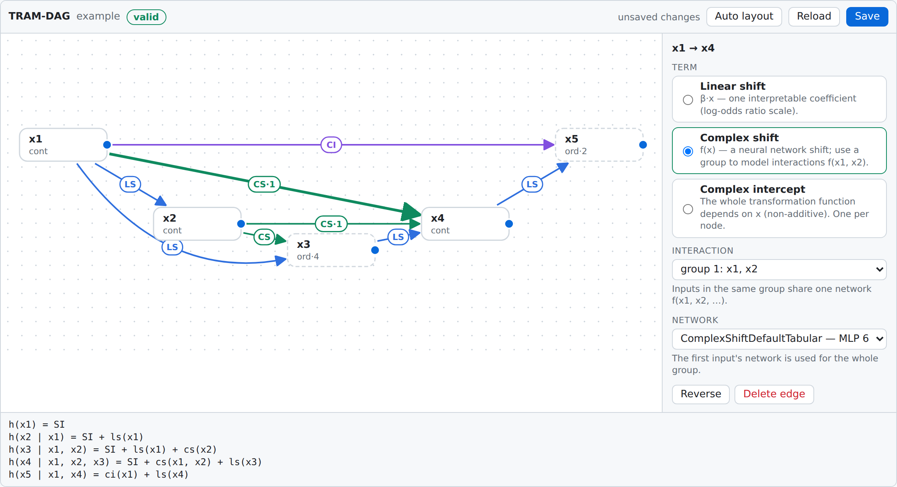

#   TRA*nsformation* M*odels* in D*irected* A*cyclic* G*raphs* (TRAMDAG)
An implementation of Interpretable Neural Causal Models with TRAM-DAGs (https://arxiv.org/abs/2503.16206), running on **JAX** (CPU / GPU / TPU).

The framework uses ordinal and continuous transformation models to learn the intercepts and linear or nonlinear shift terms that define the conditional transformation functions on each node, thereby modeling how each parent variable causally shifts the distribution of its child in the DAG.

The according implementations for the *ordinal tram* and the *continous tram* are in the github repos:

[ontram](https://github.com/liherz/ontram_pytorch) and [contram](https://github.com/buehlpa/contram_pytorch)


## What's new in 0.2

- **JAX engine.** All node models are trained jointly in one compiled program with the data on the accelerator. A full fit of the paper experiments takes **4–9 s on a GPU instead of 13–25 min** (160–210x faster; ~25x faster on CPU alone). Sampling 10 000 observations takes 0.01 s after compilation. Numerically the engine is interchangeable with the original PyTorch code (same formulas, same parameterisation, parity tests to 1e-6) and it reproduces the notebook results, see [benchmarks/REPLICATION.md](benchmarks/REPLICATION.md).
- **One-line configuration.** `TramDagConfig.from_dataframe(df, "x1 -> x2; x1, x2 -> x3 [cs]")` infers data types and ordinal levels, orders the variables causally and writes a complete `configuration.json`.
- **Visual editor.** `cfg.edit()` in a notebook (or `python -m tramdag.ui` in the browser): draw edges by dragging, pick linear shift / complex shift / complex intercept and interaction groups from a menu, see the transformation function of every node and validation errors while you edit.
- **Custom networks without touching the package**: `register_model("MyNet", hidden=(32, 32), activation="tanh")` or inline `"MLP(32,32,tanh)"`.
- The original PyTorch implementation is kept as `tramdag.legacy_torch`.

## Installation

```bash
conda create -n tramdag python=3.11
conda activate tramdag
pip install -e ".[ui]"            # from a clone of this repository
pip install "jax[cuda12]"         # optional: NVIDIA GPU support
```

The package is also on the PyPI test server (older PyTorch version):
```bash
pip install -i https://test.pypi.org/simple --extra-index-url https://pypi.org/simple tramdag
```

Extras: `ui` (notebook editor, needs `anywidget`), `torch` (original implementation in `tramdag.legacy_torch`), `dev` (tests).

**optional**: If the weights of the Intercepts and Linear Shift terms should be initialized not randomly, one can use a warmstart via R subprocess which needs an installation of R and according packages:

- install R : https://cran.r-project.org/
- install packages in R:

```bash
install.packages(c("tram", "ordinal", "readr", "MASS"))
```

## Quick start

```python
from tramdag import TramDagConfig, TramDagModel

# 1. configuration: one line (data types and ordinal levels are inferred from the data)
cfg = TramDagConfig.from_dataframe(
    train_df,
    edges="x1 -> x2; x1 -> x3; x2 -> x3 [cs]",
    experiment_dir="runs/example",
)
cfg.describe()        # data types and transformation function of every node
cfg.edit()            # optional: visual editor in the notebook

# 2. fit (all nodes jointly, GPU if available)
model = TramDagModel.from_config(cfg)
model.fit(train_df, val_df, epochs=200, batch_size=1000, learning_rate=0.01)

# 3. diagnostics
model.plot_loss_history()
model.coefficients()                  # all interpretable linear shifts as a table
model.plot_latents(train_df)          # latents should be standard logistic

# 4. sampling
obs, _ = model.sample()                                   # L1 observational
do, _ = model.sample(do_interventions={"x1": 0.5})        # L2 interventional
u = model.get_latent(observed_rows)                       # L3 counterfactual: abduction ...
cf, _ = model.sample(do_interventions={"x1": 0.5}, predefined_latent_samples_df=u)  # ... action + prediction
```

### Describing the graph

| edge syntax | meaning |
|---|---|
| `x1 -> x2` | linear shift `ls(x1)` (default, interpretable coefficient) |
| `x1 -> x2 [cs]` | complex shift: a neural network `f(x1)` |
| `x1 -> x2 [ci]` | complex intercept: the whole transformation function depends on `x1` |
| `x1, x2 -> x3` / `x1 -> x2 -> x3` | several edges / chains |
| `(x1, x2) -> x3 [cs]` | interaction: one network `f(x1, x2)` (written as `cs11`, `cs12` in the configuration) |
| `x2 -> x3 [cs, model=MLP(32,32,tanh)]` | choose the network (registered name or inline MLP) |
| `x3 : ordinal(4)` | declare a node (when there is no data frame) |

Configurations can be edited later with `cfg.add_edges("x1 -> x3 [cs]")`, `cfg.remove_edge("x1", "x3")`, `cfg.set_node("x3", data_type="ordinal", levels=4)` and `cfg.set_training(epochs=300)`, or visually with `cfg.edit()`. The old step-by-step workflow (`setup_configuration`, `set_data_type`, `set_meta_adj_matrix`, `set_tramdag_nn_models`) still works and produces the same file.

### Visual editor



- **Notebook** (JupyterLab, Notebook 7, VS Code, Colab): `cfg.edit()` or `DagEditor(cfg, df)`.
- **Browser** without Jupyter: `python -m tramdag.ui runs/example/configuration.json --data train.csv` (or `tramdag-editor ...` after `pip install`).

Drag from the dot on the right side of a node onto another node to add an edge, click an edge to set the term, interaction group and network, click a node to set data type and levels. The footer shows the transformation function of every node and all validation errors (cycles, invalid interaction groups, missing levels, unknown networks); **Save** writes `configuration.json`.

## Documentation
Read the guide below for usage instructions
- [HOW-TO](how_to_use/typical_workflow.md)
- [How to sample](how_to_use/sampling.md)
- [Ordinal and continuous variables](how_to_use/Ordinal_Continous_vars.md)


Full API CODE documentation
- [Code Documentation](https://buehlpa.github.io/TramDag/tramdag.html)


## Example Notebooks

under /example_notebooks some examples are displayed

- [0 Quick start with the JAX engine, the one-line configuration and the editor](example_notebooks/0_quickstart_jax.ipynb)

Reproducing simulation experiments from [TRAMDAG paper](https://arxiv.org/abs/2503.16206) (these notebooks were run with the original PyTorch engine; [benchmarks/replicate_examples.py](benchmarks/replicate_examples.py) re-runs all of them with the JAX engine and compares the results, see [benchmarks/REPLICATION.md](benchmarks/REPLICATION.md))


- [6.1 Continous_complex DGP complex Shift (L1 L2)](example_notebooks/Continous_3_vars_complex_DGP_CS.ipynb)[](https://colab.research.google.com/github/buehlpa/tramdag/blob/main/example_notebooks/Continous_3_vars_complex_DGP_CS.ipynb)
- [6.1 Continous_linear DGP complex Shift  (L1 L2)](example_notebooks/Continous_3_vars_linear_DGP_CS.ipynb)[](https://colab.research.google.com/github/buehlpa/tramdag/blob/main/example_notebooks/Continous_3_vars_linear_DGP_CS.ipynb)
- [6.1 Continous_linear DGP linear Shift   (L1 L2)](example_notebooks/Continous_3_vars_linear_DGP_LS.ipynb)[](https://colab.research.google.com/github/buehlpa/tramdag/blob/main/example_notebooks/Continous_3_vars_linear_DGP_LS.ipynb)
- [6.2 Mixed_linear DGP complex Shift      (L1 L2 L3)](example_notebooks/Mixed_3_vars_linear_DGP_LS.ipynb)[](https://colab.research.google.com/github/buehlpa/tramdag/blob/main/example_notebooks/Mixed_3_vars_linear_DGP_LS.ipynb)

if you are using the notebook in colab install tramdag and the r packages with:

```bash
pip install -i https://test.pypi.org/simple --extra-index-url https://pypi.org/simple tramdag
!R -e "install.packages(c('tram','ordinal'),repos = c(ETH = 'https://stat.ethz.ch/CRAN',CRAN = 'https://cloud.r-project.org'))"
```
### More examples

Examples with simulated data can be found in the repository:
[github.com/buehlpa/causality_ukb](https://github.com/buehlpa/causality_ukb)

## Development

```bash
pip install -e ".[dev]"
pytest                                   # engine, configuration, editor and torch parity tests
python benchmarks/replicate_examples.py  # re-run the paper experiments, writes benchmarks/REPLICATION.md
python -m playwright install chromium && python benchmarks/ui_e2e.py   # editor end-to-end in JupyterLab
```

## Limitations


- Maximum input per **node** for  Complex Shift or Complex intercept is **9**
- Currently only tabular data is supported in the JAX engine; image terms are available in `tramdag.legacy_torch`.
## Authors

- [@buehlpa](https://www.github.com/buehlpa)
- [@oduerr](https://www.github.com/oduerr)
- [@bsick](https://www.github.com/bsick)


## Citation
If you intend to use this repository for your experiments please cite:


```
@misc{sick2025interpretableneuralcausalmodels,
  title={Interpretable Neural Causal Models with TRAM-DAGs},
  author={Beate Sick and Oliver Dürr},
  year={2025},
  eprint={2503.16206},
  archivePrefix={arXiv},
  primaryClass={stat.ML},
  url={https://arxiv.org/abs/2503.16206}
}
```
